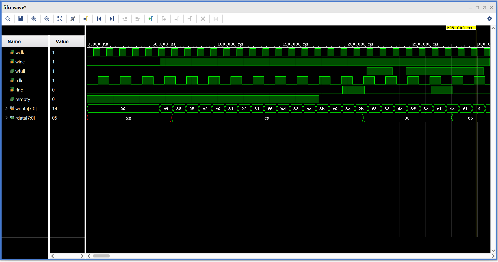
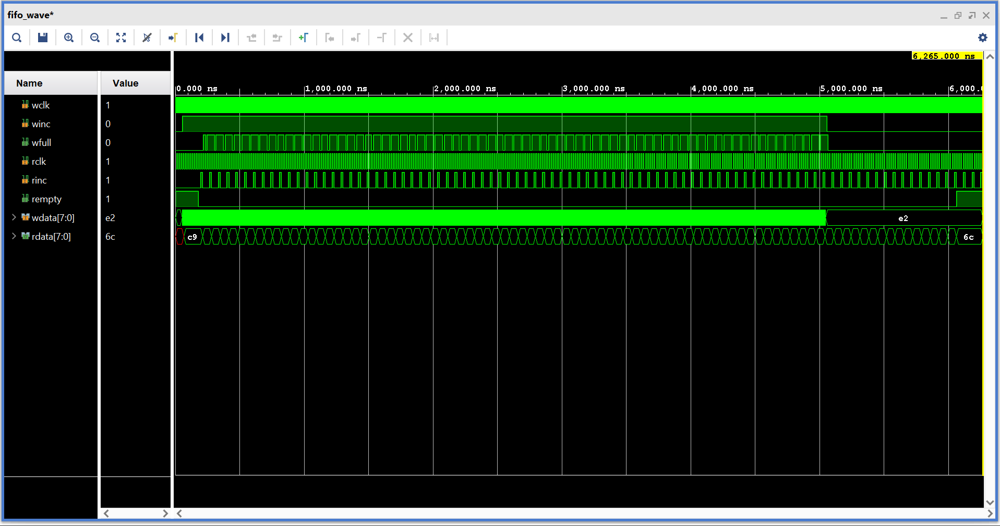
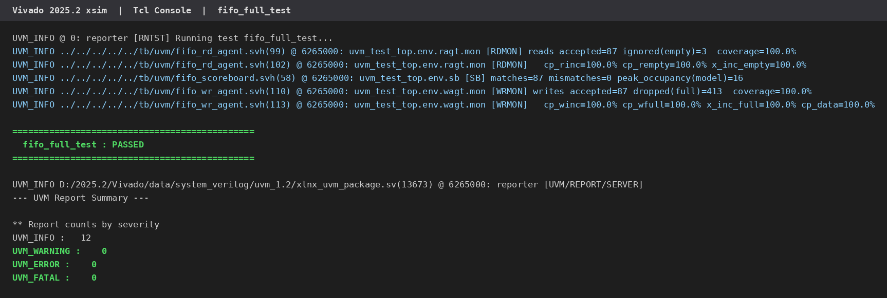

# Async FIFO: RTL Design and UVM Verification

[](https://github.com/Mahendr99ar/async-fifo-uvm/actions/workflows/ci.yml)


Author: [Mahendra Meena](https://github.com/Mahendr99ar)

This is a dual-clock FIFO written in SystemVerilog, with a UVM testbench to verify it. The
write side and the read side run on different, unrelated clocks, so the main problem is
passing the read and write pointers between the two clock domains without corrupting them.

I built it to practice design verification: constrained-random stimulus, a scoreboard,
assertions and functional coverage. All three tests pass in Vivado 2025.2 and the merged
functional coverage is 100 %.

```
          WRITE CLOCK DOMAIN (wclk)                         READ CLOCK DOMAIN (rclk)

   winc, wdata ──► ┌──────────────┐   waddr   ┌──────────┐   raddr   ┌──────────────┐ ◄── rinc
                   │ write pointer│──────────►│ dual-port│◄──────────│ read pointer │
                   │ binary + gray│           │   RAM    │──► rdata  │ binary + gray│
   wfull ◄──────── │  full logic  │           │ 16 x 8b  │           │ empty logic  │ ──────► rempty
                   └──────┬───────┘           └──────────┘           └──────┬───────┘
                          │ gray wptr                                gray rptr │
                          │            ┌──────────────────┐                    │
                          └───────────►│ 2-FF synchronizer│──► (to read side)  │
                   (to write side) ◄───│ 2-FF synchronizer│◄───────────────────┘
                                       └──────────────────┘
```



The waveform above is the first 300 ns of `fifo_full_test`. Writes start at about 55 ns
(`c9`, `38`, `05`, ...). `rempty` stays high until about 180 ns because the read side comes
out of reset later and the write pointer then needs two `rclk` cycles to get through the
synchronizer. `rdata` shows `c9`, `38`, `05` in the same order they were written. Around
215 ns `wfull` goes high while `winc` is still high, so those writes are blocked. Each
`rinc` pulse frees one slot, `wfull` drops for a short time, one more write goes in, and
`wfull` goes high again.

## Features

| Area | What I implemented |
|------|--------------------|
| Design | Depth `2^ASIZE` and width `DSIZE` as parameters, Gray-coded pointers, 2-flop synchronizers, show-ahead read |
| Overflow / underflow | A write when full or a read when empty is ignored by the hardware |
| UVM environment | Write agent and read agent (sequencer, driver, monitor each), in-order scoreboard, env, 3 tests |
| Stimulus | Random data and random idle delays; `dist` constraint to make `0x00` and `0xFF` more likely |
| Checking | Scoreboard compares every accepted read against the expected write; SVA module bound into the RTL |
| Assertions | Gray pointer changes at most 1 bit per clock; pointer does not move on write when full or read when empty |
| Coverage | Covergroups on both sides: `winc × wfull`, `rinc × rempty`, data value bins, with per-coverpoint numbers in the log |
| Clock ratios | Clock periods set from the command line with `+WCLK_PERIOD` and `+RCLK_PERIOD` |
| CI | GitHub Actions runs Verilator lint and an Icarus self-checking test on every push |

## Results

All runs: Vivado 2025.2 xsim, UVM 1.2, 500 write attempts per test.

| Test | Clocks (w:r) | Writes accepted | Writes blocked (full) | Reads ignored (empty) | Mismatches | Result |
|------|--------------|-----------------|-----------------------|-----------------------|------------|--------|
| `fifo_random_test` | 10 : 17 ns | 306 | 194 | 4 | 0 | PASSED |
| `fifo_full_test` | 10 : 17 ns | 87 | 413 | 3 | 0 | PASSED |
| `fifo_empty_test` | 17 : 10 ns | 500 | 0 | 2914 | 0 | PASSED |

UVM_ERROR: 0, UVM_FATAL: 0, assertion failures: 0.

This is the full 6.3 µs run of `fifo_full_test`. `winc` is high almost the whole time, `wfull`
keeps toggling as the slow reader frees one slot at a time, and `rempty` is high only at the
start and at the end.



### Coverage

My first run showed 93.8 % coverage on the write side. The data coverpoint has single-value
bins for `0x00` and `0xFF`, and plain random data rarely hits them. I added a `dist`
constraint to give those two values more weight. The first version used the unsized literal
`'1`, and coverage was still 93.8 %. I changed it to `{DSIZE{1'b1}}` and also made the
monitors print coverage for each coverpoint separately. After that every coverpoint showed
100 %.

The empty test never fills the FIFO, so on its own it only reaches 75 % on the write side.
That is expected. I look at coverage merged across all three tests.

| Covergroup | random | full | empty | Merged |
|------------|--------|------|-------|--------|
| Write side | 93.8 %* | 100 % | 75 % | **100 %** |
| Read side | 100 % | 100 % | 91.7 % | **100 %** |

\* This run was done before the coverage fix.

### Does the testbench catch bugs?

To check this, the full-flag comparison in the RTL was broken on purpose (only the MSB
inverted instead of the top two bits). The FIFO then said it was full too early and
overwrote data, and the self-checking test failed right away with `wfull not set` and
`data mismatch` errors.

## How to run

**Vivado GUI** (easiest if you want waveforms)
1. In Vivado: **Tools → Run Tcl Script…** and pick `sim/create_vivado_project.tcl`
2. **Run Simulation → Run Behavioral Simulation**
3. To run a different test, go to **Simulation Settings → Simulation** and change
   `xsim.simulate.xsim.more_options`:
   ```
   -testplusarg UVM_TESTNAME=fifo_full_test
   -testplusarg UVM_TESTNAME=fifo_empty_test -testplusarg WCLK_PERIOD=17 -testplusarg RCLK_PERIOD=10
   ```

**Vivado command line**
```bash
# Linux: source <Vivado>/settings64.sh      Windows: run <Vivado>\settings64.bat
cd sim
./run_xsim.sh fifo_full_test          # Windows: run_xsim.bat fifo_full_test
./run_xsim.sh fifo_empty_test 17 10   # test, wclk ns, rclk ns
./run_xsim.sh all                     # 3 tests x 3 clock ratios
```

**Free tools** (same checks as CI)
```bash
make lint        # Verilator -Wall
make directed    # Icarus Verilog self-checking test
```

## Project structure

```
async-fifo-uvm/
├── rtl/
│   ├── async_fifo.sv            FIFO: pointers, full/empty logic, memory
│   └── sync_2ff.sv              2-flop synchronizer
├── tb/
│   ├── uvm/
│   │   ├── tb_top.sv            clocks, resets, DUT, run_test()
│   │   ├── fifo_if.sv           interface with per-domain clocking blocks
│   │   ├── fifo_pkg.sv          package including all classes below
│   │   ├── fifo_items.svh       write / read sequence items + constraints
│   │   ├── fifo_wr_agent.svh    write driver, monitor (+covergroup), agent
│   │   ├── fifo_rd_agent.svh    read driver, monitor (+covergroup), agent
│   │   ├── fifo_scoreboard.svh  in-order reference model
│   │   ├── fifo_env.svh         environment
│   │   ├── fifo_seqs.svh        write / read sequences
│   │   ├── fifo_tests.svh       random, full, empty tests
│   │   └── fifo_sva.sv          assertions, bound into async_fifo
│   └── directed/
│       └── tb_fifo_directed.sv  lightweight test for CI
├── sim/                         Vivado scripts (Tcl project, .sh, .bat)
├── docs/                        verification plan, screenshots, log
└── .github/workflows/ci.yml     lint + directed test on every push
```

Which check covers which feature: [docs/verification_plan.md](docs/verification_plan.md)

## Design notes

- **Gray code for the pointers.** Only one bit changes per increment. If the synchronizer
  samples while the pointer is changing, it gets either the old value or the new one. A
  binary pointer can change several bits at once, so it can be sampled as a value it never had.
- **Pointers are one bit wider than the address.** With `ASIZE+1` bits, equal pointers mean
  empty. Pointers that are equal except for the top two Gray bits mean full.
- **Flags are pessimistic.** Because of the 2-cycle synchronizer delay, `wfull` and `rempty`
  can stay high a little longer than needed. They are never wrong, so the cost is a few cycles
  of throughput, not correctness.
- **The drivers ignore full and empty on purpose.** They keep writing when the FIFO is full
  and keep reading when it is empty, so the protection logic gets exercised in every test. The
  monitors only send accepted transactions to the scoreboard.
- **One clocking block per domain** for drivers and monitors, to avoid races with the design at
  the clock edge.
- **Assertions are attached with `bind`**, so the RTL file only has synthesizable code.

## Limitations and next steps

- Vivado xsim ignores `cover property`, so I cover the same cases with covergroup crosses.
- The clock ratio is fixed for a whole run. I have not tested changing frequency mid-run.
- No gate-level simulation or X-propagation checks yet.
- Next I want to add almost-full / almost-empty flags, prove the Gray-code property formally
  with SymbiYosys, and take the design through RTL-to-GDS with OpenLane on sky130.



Full simulator log: [docs/fifo_full_test_xsim_log.txt](docs/fifo_full_test_xsim_log.txt)
